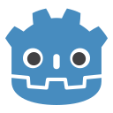
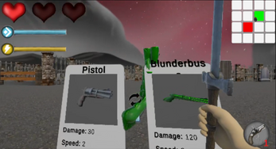
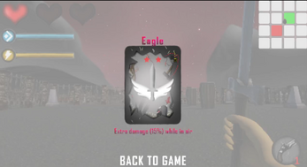
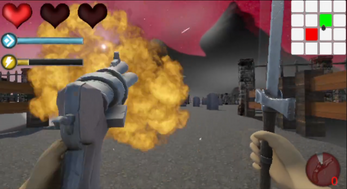
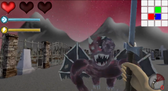
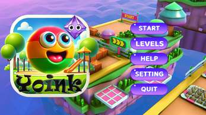
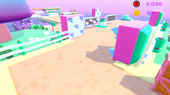
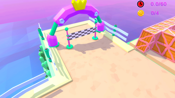

### Hi there 👋, my name is Hanlin Ni, you can also call me Nesson😁
#### Game programmer, developer 
I'm a Game Programmer working with Unity and Godot, with a focus on gameplay programming and system development.
Currently focused on game programming, with a strong interest in gameplay mechanics, performance optimization, and independent game development.

# Tools & Softwares:
  

# Social Links
    

# Experiences 
## 🎮 Necrofest

    
    
    
    
    
    

    
    

    
    

Necrofest is a roguelike party where everything wants you dead, but at least you get cool weapons and questionable magical powers along the way. Slice enemies up close, shoot them from afar, or let your deck of chaotic abilities do the questionable decision-making for you.

Build ridiculous card combos, pick powers you probably shouldn’t trust, and stumble deeper into dungeons that absolutely do not meet safety regulations. Every run is different: sometimes you become an unstoppable monster, and sometimes you trip over your own spell and explode. That’s the fun!

**My Contribution**
- **Main Programmer:** Took primary responsibility for the game's programming and gameplay system implementation. Including RPG System, Card Effects and Dungeon Builder.

  
  
  /
  

### 🎬 Gameplay Trailer

  

## 🎮 Yoink

    
    
    

    
    

    

A chaotic 3D bouncing adventure where gravity takes a day off and reflexes are put to the test.

Bounce through challenging obstacles, navigate unpredictable platforms, avoid deadly traps, and collect shiny items on your way to victory. Easy to pick up, but much harder to master.

**My Contribution**
- **Level Design:** Designed and built game levels, including platform layouts, obstacles, and gameplay challenges.

  
  
  

**[▶ Play on itch.io](https://calipurn-neeson.itch.io/yoink)**

