### Hi there 👋, my name is Hanlin Ni, you can also call me Nesson😁
#### Game programmer, developer 
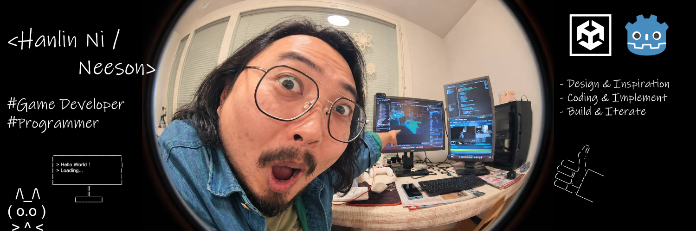
I'm a Game Programmer working with Unity and Godot, with a focus on gameplay programming and system development.
Currently focused on game programming, with a strong interest in gameplay mechanics, performance optimization, and independent game development.

# Tools & Softwares:
  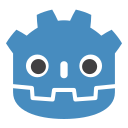

# Social Links
    

 
 

---

# Internship Experiences — Hovi (Finland)

Worked as a Game Programmer, contributing to multiple game development projects.

Key Responsibilities：
- Implemented gameplay mechanics and features.
- Developed and maintained gameplay systems.
- Integrated features into existing projects and collaborated with team members.
- Worked on visual effects and particle systems.

## 🎮 Niki's Threads & Needles
**My Contribution**
- **Particle Systems:** Created and implemented particle effects for stage visuals, enhancing the game's atmosphere and visual presentation.
- **UI Development:** Implemented interactive UI features, including a smartphone-style interface.

  
  

## 🎮 Necroveil
**My Contribution**
- **Strafe Jump:** Implemented strafe jumping mechanics to enhance player movement and mobility.
- **Combat Feedback:** Developed combat feedback effects, including camera shake, impact visual effects, and hit-stop to make combat interactions feel more responsive and impactful.

  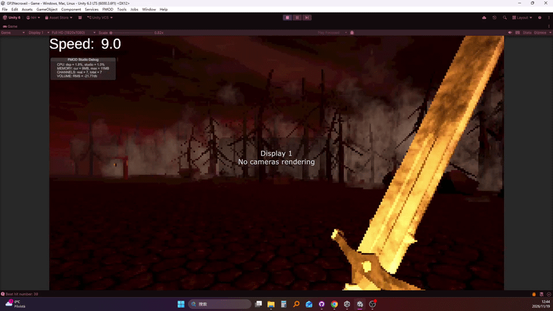
  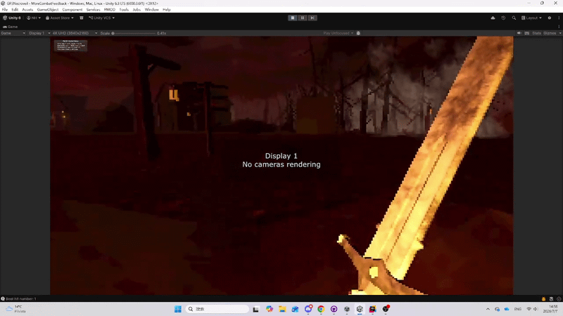

---

# Project Experiences 
## 💻🚥🚗🚚🚛 Unity DOTS Traffic Simulation

    
    
    
    

**My Contribution**
- **System Architecture:** Designed and implemented an ECS-based traffic simulation system using Unity DOTS.
- **Traffic Simulation:** Developed vehicle movement, waypoint navigation, road networks, traffic lights, and vehicle-following systems.
- **Performance Optimization:** Applied Burst Compiler and Job System to improve simulation performance.
- **Performance Testing:** Conducted experiments with different vehicle counts to evaluate frame time, CPU workload, and memory usage.

  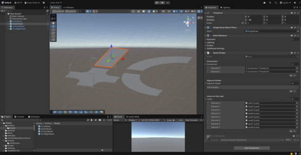
  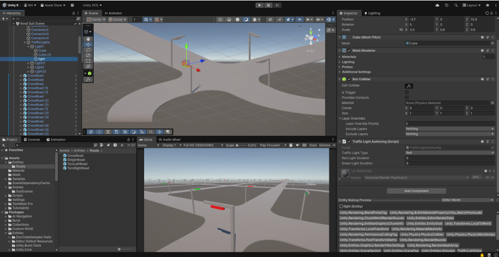
  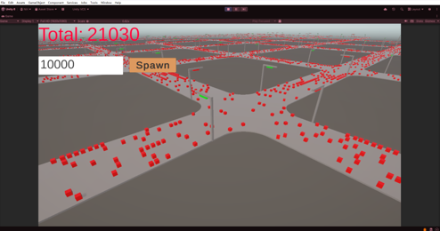

**Resources**
- **[🎬 YouTube Video](https://www.youtube.com/watch?v=tL8uUxcMt5k)**
- **[📄 Read My Thesis]()**
- **[💻 Source Code](https://github.com/Calipur-Neeson/Unity_DOTS_Tutorial_SimpleTrafficStimulation.git)**

 
 

---

## 🎮 Raft_Mod

    
    
    
    

A mod for Raft that extends the original game with additional
features and gameplay functionality.

**My Contribution**
- **Mod Development:** Reverse engineering for Raft, implement new features to existing system.

  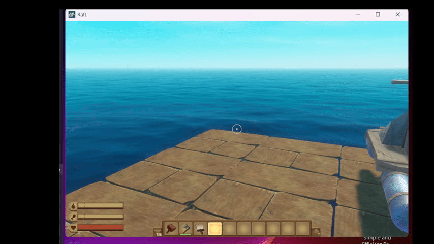
  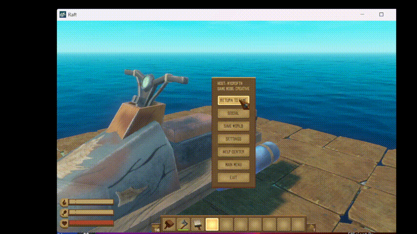

 
 

**[🌐 Mod Page](https://www.nexusmods.com/raft/mods/134)**

---

## 🥽ᯅ🎮 Educational VR Game

    
    

    
    
    

    

The game allows players to take on the role of a teacher, experience common classroom scenarios, and enhance their problem-solving and decision-making skills.​

**My Contribution**
- **Main Programmer:** Implemented VR gameplay features and interactions for the classroom simulation.

  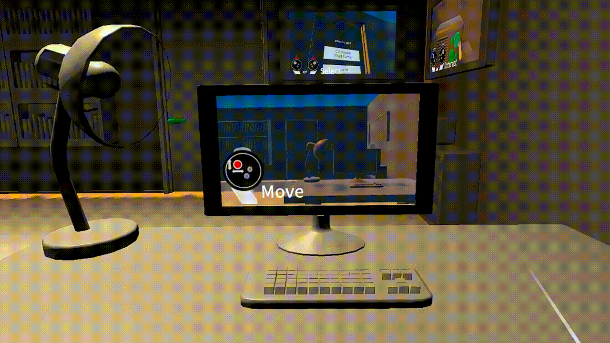
    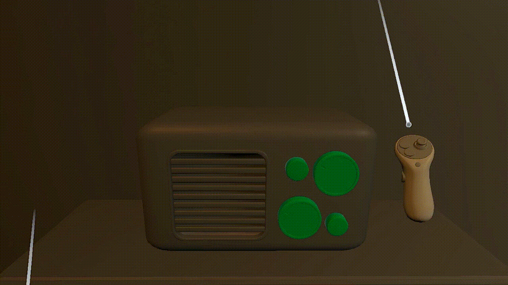
    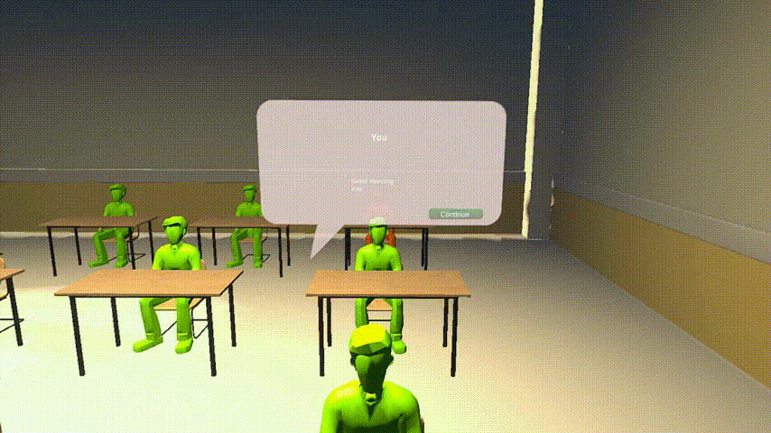

 
 

---

## 🎮 Daisy Town Disaster

    
    
    
    
    
    
    

    
    

    

The Lucky 4 cowboys must save Daisy Town from the evil Cassidy family's powerful mechanical contraptions. In the 3D CO-OP shooter that blends wild west action with bullet-hell battles.

**My Contribution**
- **Main Programmer:** Multiplay system and bullet hell design 

  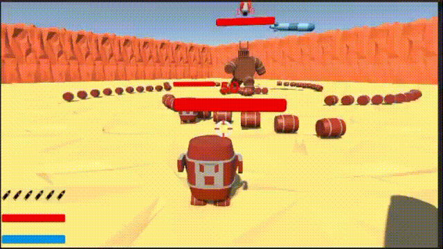

**[✨ Instagram Page](https://www.instagram.com/daisytowndisaster?dlrf=dG5ldjJ2NHczbG5u)**

 
 

---

## 🎮 Necrofest

    
    
    
    
    
    

    
    

    
    

Necrofest is a roguelike party where everything wants you dead, but at least you get cool weapons and questionable magical powers along the way. Slice enemies up close, shoot them from afar, or let your deck of chaotic abilities do the questionable decision-making for you.

Build ridiculous card combos, pick powers you probably shouldn’t trust, and stumble deeper into dungeons that absolutely do not meet safety regulations. Every run is different: sometimes you become an unstoppable monster, and sometimes you trip over your own spell and explode. That’s the fun!

**My Contribution**
- **Main Programmer:** Took primary responsibility for the game's programming and gameplay system implementation. Including RPG System, Card Effects and Dungeon Builder.

  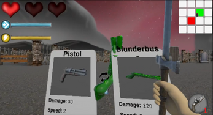
  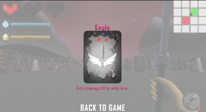
   
  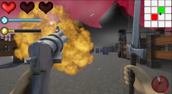
  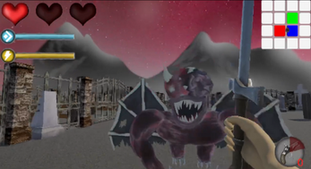

**[🎬 Gameplay Trailer](http://www.youtube.com/watch?feature=player_embedded&v=U0f2WEjFt5Q)**

**[▶ Play on itch.io](https://calipurn-neeson.itch.io/necrofest)**

 
 

---

## 🎮 Yoink

    
    
    

    
    

    

A chaotic 3D bouncing adventure where gravity takes a day off and reflexes are put to the test.

Bounce through challenging obstacles, navigate unpredictable platforms, avoid deadly traps, and collect shiny items on your way to victory. Easy to pick up, but much harder to master.

**My Contribution**
- **Level Design:** Designed and built game levels, including platform layouts, obstacles, and gameplay challenges.

  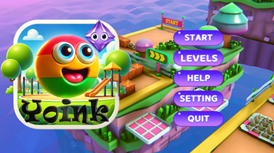
  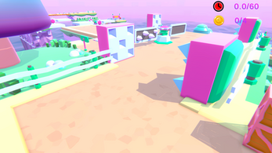
  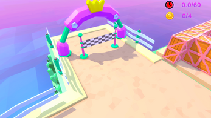

**[▶ Play on itch.io](https://calipurn-neeson.itch.io/yoink)**

